<!-- Every card is an animated SVG drawn by scripts/render_readme_cards.py and refreshed daily
     by .github/workflows/update-profile.yml. Design inspired by Avi Vashishta's "Three Worlds"
     editorial paper & ink architecture, customized for Aditya Nair (@A2ZCoder404).
     Spacing is baked into the SVGs, so keep this block free of blank lines and keep the cards in
     a row on one line with no spaces between them. -->

 
 
 
 
<picture><source media="(prefers-color-scheme: dark)" srcset="./cards/title-coding-dark.svg" /><source media="(prefers-color-scheme: light)" srcset="./cards/title-coding-light.svg" /></picture> 

<a href="https://a2zcoder404.com">a2zcoder404.com</a> &nbsp;/&nbsp; <a href="https://twitter.com/zcoder404">twitter: @zcoder404</a> &nbsp;/&nbsp; <a href="https://github.com/A2Zcoder404">github: @A2ZCoder404</a>

 

<b>📐 Click to Expand Engineering Architecture &amp; Interactive Diagrams</b>

 

    
    
    
  

