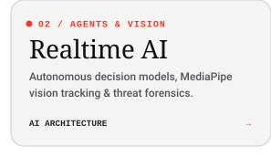
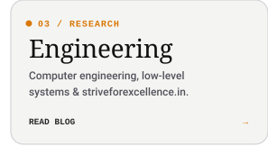
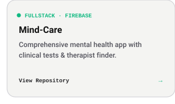
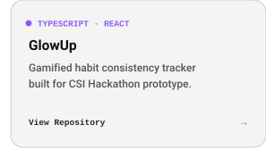
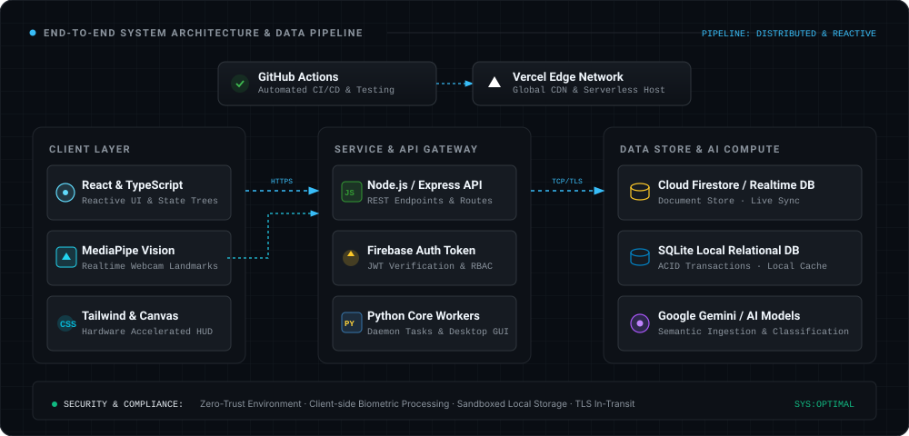
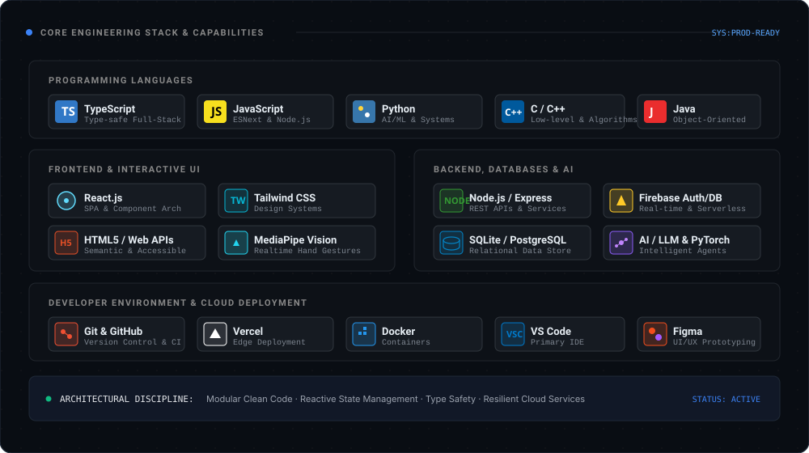

<!-- Every card is an animated SVG drawn by scripts/render_readme_cards.py and refreshed daily
     by .github/workflows/update-profile.yml. Design inspired by Avi Vashishta's "Three Worlds"
     editorial paper & ink architecture, customized for Aditya Mohan Nair (@A2ZCoder404).
     Spacing is baked into the SVGs, so keep this block free of blank lines and keep the cards in
     a row on one line with no spaces between them. -->

 
 
 
 
 

<a href="https://striveforexcellence.in">striveforexcellence.in</a> &nbsp;/&nbsp; <a href="https://twitter.com/zcoder404">twitter: @zcoder404</a> &nbsp;/&nbsp; <a href="https://github.com/A2Zcoder404">github: @A2ZCoder404</a>

 

<b>📐 Click to Expand Engineering Architecture &amp; Interactive Diagrams</b>

 

    
    
    
  

